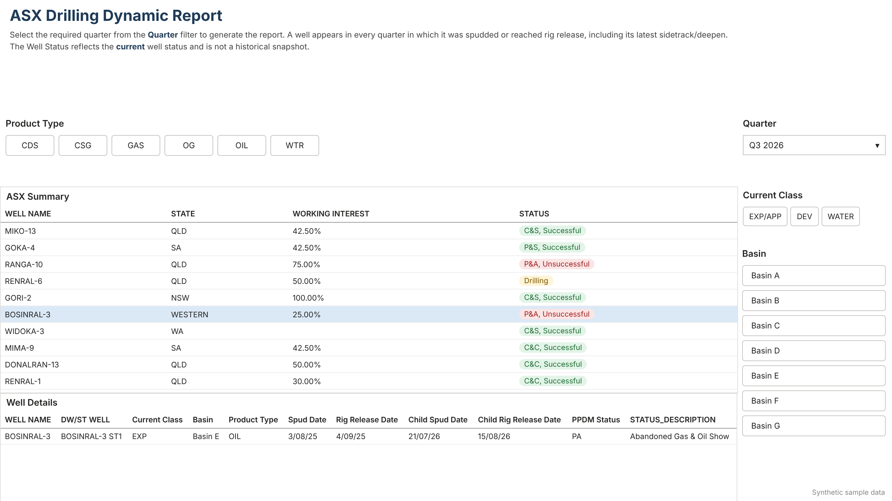
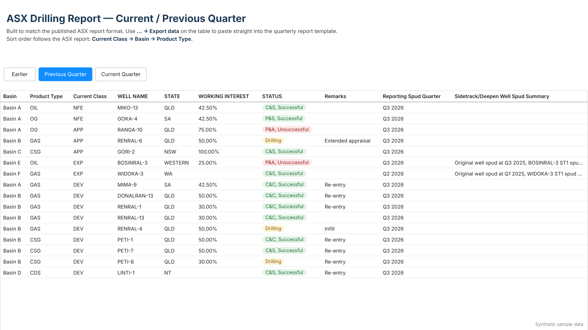
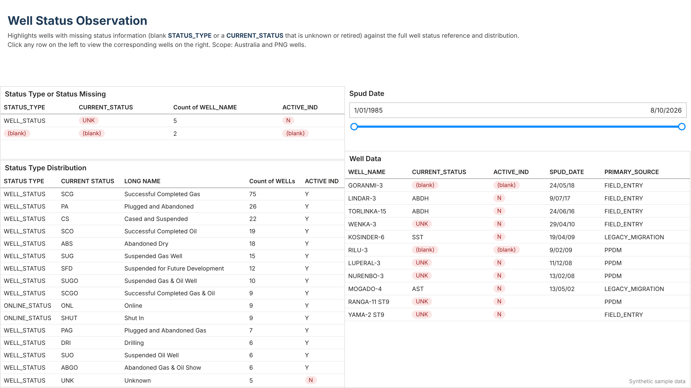
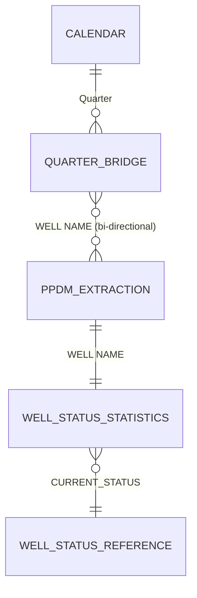
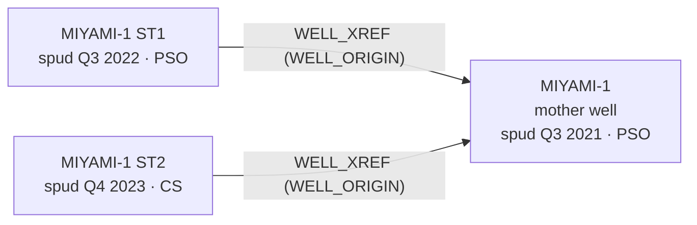

# ASX Quarterly Drilling Report — Power BI on PPDM

A Power BI (PBIP / TMDL) reporting solution that turns a **PPDM 3.8** well master-data store into the well and drilling activity tables an ASX-listed E&P company publishes in its quarterly activities report.

> **Portfolio note.** This is a sanitised version of a production report. Server names, company and business-unit identifiers, joint-venture names, working-interest percentages, internal user names and all cached data have been removed or replaced with illustrative values. The SQL, data model and report logic are otherwise unchanged. The repo includes a **synthetic sample dataset**, generated for this portfolio with no real wells, so the report can be refreshed without database access.

---

## Preview

*Rendered from the synthetic sample data. These are HTML recreations of the page layouts, generated by `scripts/render_previews.py`.*

**Dynamic Report**: pick a quarter and every well with a drilling milestone in it appears. Selecting a well shows its details, including the latest sidetrack.



**Current / Previous Quarter**: the review list for the reporting quarter, in the same Class → Basin → Product order as the published ASX table, so reviewers can compare line by line.



**Well Status Observation**: data-quality view of wells with unknown, blank or retired status codes.



---

## What it does

Every quarter, the drilling section of an ASX activities report has to answer: *which wells were spudded or reached rig release this quarter, what are they, where are they, what's our interest and what was the outcome?*

**This report is a review tool, not the publication itself.** It pulls the answer straight from the well master database (PPDM) and puts it in front of the people who know each asset (operations, subsurface and JV/commercial) before anything is published. Their job is to catch what the database got wrong:

* wells that were drilled but are **missing** or incomplete in PPDM (no spud date, no business unit, no operator);
* wells with the **wrong status, class, basin or permit**;
* sidetracks and deepens that are **not linked** to their mother well;
* JV contracts with **no working interest** mapped.

Each issue is fixed at the source in PPDM, not patched in the report. That way each quarter's review also improves the master data.

To support that, the solution:

* extracts the in-scope well population directly from PPDM with one documented SQL query;
* consolidates **sidetrack and deepen** wellbores back to the mother well, so drilling activity is reported once at the right level;
* lets a well appear in **every quarter where any drilling milestone occurred** (parent spud, parent rig release, child spud, child rig release);
* maps detailed PPDM status codes into ASX-style outcome categories (C&S, P&A, etc.);
* sorts the output in the same Class → Basin → Product order as the published report, so reviewers can compare it line by line;
* includes data-quality and documentation pages so the report can be checked and maintained.

---

## Report pages

| Page | Purpose |
| --- | --- |
| **Dynamic Report** | Interactive well-level view filtered by quarter, well category, basin and product type |
| **Current Quarter** | Current and previous quarter view laid out to match the ASX table format |
| **Well Status Observation** | Data-quality review: wells with missing `STATUS_TYPE` or a `CURRENT_STATUS` that doesn't match the reference table |
| **Column Definitions** | In-report data dictionary for every output field |
| *Reference Table Change History* (hidden) | Developer page for investigating changes to the `R_WELL_STATUS` reference table |

---

## Data model



| Table | Source | Role |
| --- | --- | --- |
| `PPDM Extraction` | Oracle SQL on PPDM | Main fact: one row per original surface well |
| `Calendar` | Power Query (generated) | Quarter dimension from Q1 2020 to the current quarter, with Current / Previous / Earlier flags |
| `Quarter Bridge` | Power Query (from extraction) | Unpivots the four milestone quarters into a well-to-quarter bridge |
| `Well Status Statistics` | Oracle SQL on PPDM | Well-level status resolved against the reference table on the composite key |
| `Well Status Reference` | Oracle SQL on PPDM | `R_WELL_STATUS` filtered to `WELL_STATUS` and `ONLINE_STATUS` |
| `Column Definition` | Embedded table | Field documentation shown on the Column Definitions page |

---

## Design decisions

### 1. Mother well and child wellbores (sidetracks and deepens)

This is the most involved part of the logic, so it is covered in detail here.

#### Terminology

| Term | Meaning |
| --- | --- |
| **Mother well** (parent, original surface well) | The well drilled from surface. It is the unit the ASX report counts. |
| **Child wellbore** | A sidetrack (`ST1`, `ST2`, …) or deepen (`DW1`, …) drilled later from the mother well's bore. |
| **Latest child** | The child with the most recent valid spud date. |

#### How PPDM stores it

PPDM stores every wellbore, mother or child, as its own row in `WELL` with its own UWI, spud date, rig release date and status. The parent-child link is held in `WELL_XREF`:

```text
WELL_XREF.UWI       = child UWI
WELL_XREF.UWI2      = mother well UWI
WELL_XREF.XREF_TYPE = 'WELL_ORIGIN'
```



Counting raw `WELL` rows would report this drilling activity as three wells. The ASX report counts it as **one well** with a later sidetrack.

#### Rules applied in the extraction

1. **One row per mother well.** Any UWI that appears as a child in `WELL_XREF` (`WELL_ORIGIN`) is excluded from the top-level population.
2. **Pick the latest child.** For each mother well, `FIRST_VALUE(...) OVER (PARTITION BY mother ORDER BY spud_date DESC)` returns the most recent child's name, status, spud date and rig release date in one pass.
3. **Ignore children without a usable spud date.** Children with a null spud date, or a placeholder date before 1900, can't be ordered and are left out of step 2. They should be reviewed as a data-quality issue.
4. **Status comes from the latest child.** If a valid child exists, its status drives both `PPDM Status` and the grouped ASX `STATUS`, because the latest wellbore reflects the well's current outcome. Otherwise the mother well's own status is used.
5. **Dates are kept separately.** `Spud Date` and `Rig Release Date` are always the mother well's own dates. The latest child's dates go in `Child Spud Date` and `Child Rig Release Date`.
6. **Reporting quarter follows the latest activity.** `Reporting Spud Quarter` uses the latest child's spud quarter when there is one, and the mother's otherwise.
7. **Every milestone reaches the quarter filter.** `Quarter Bridge` unpivots the mother's spud and rig release quarters and the latest child's spud and rig release quarters, so the mother well appears in each of those quarters (see section 3).

#### Worked example (from the sample data)

| Wellbore | Spud | Status | Reported? |
| --- | --- | --- | --- |
| MIYAMI-1 (mother) | 20/09/2021 | PSO — Plugged & Suspended Oil | Yes, as the row |
| MIYAMI-1 ST1 | 12/09/2022 | PSO | No (not the latest child) |
| MIYAMI-1 ST2 | 18/11/2023 | CS — Cased and Suspended | Yes, as the latest child |

This produces a single report row:

| Column | Value | Source |
| --- | --- | --- |
| `WELL NAME` | MIYAMI-1 | Mother well |
| `DW/ST WELL` | MIYAMI-1 ST2 | Latest child |
| `Spud Date` / `Rig Release Date` | 20/09/21 / 6/11/21 | Mother well |
| `Child Spud Date` / `Child Rig Release Date` | 18/11/23 / 24/11/23 | Latest child |
| `PPDM Status` → `STATUS` | CS → **C&S, Successful** | Latest child, not the mother's PSO |
| `Reporting Spud Quarter` | Q4 2023 | Latest child |
| Quarters the well appears in | Q3 2021, Q4 2021, Q4 2023 | Mother spud, mother rig release, child spud/rig release |
| `Sidetrack/Deepen Well Spud Summary` | Original well spud at Q3 2021, MIYAMI-1 ST2 spud at Q4 2023 | Generated text |

#### Edge cases and known limitations

* **Child still drilling.** The child has no rig release date yet and its status is `DRI`, so the mother well reports as **Drilling** in the child's spud quarter, even if the mother itself finished years earlier. This is intended, because there is active drilling on that well.
* **Intermediate children aren't reported.** Only the latest child is carried. In the example above, ST1's spud quarter (Q3 2022) does not appear in `Quarter Bridge`, so filtering on Q3 2022 won't return MIYAMI-1. Reviewers of that quarter need to know this. If every sidetrack has to be visible in its own quarter, the next step is a child-level table related to `Quarter Bridge`.
* **Sidetrack of a sidetrack.** The logic assumes `WELL_ORIGIN` always points to the original surface well. If a source system links ST2 to ST1 instead of to the mother, ST2 is grouped under ST1 and needs a recursive (`CONNECT BY`) lookup.
* **Comparing with raw counts.** The report intentionally has fewer rows than a raw `WELL` count for the same period. `Well Status Statistics` still holds every wellbore, including children, which is why the status data-quality pages show more wells than the drilling report.
* **Child with no spud date.** These children are excluded by rule 3, so the mother falls back to its own status, or to the latest child that does have a valid date. They are a data-quality gap worth fixing at the source. The sample data includes two such children (`… ST9`) to show this.

### 2. Working interest: an interim mapping, on purpose

There is not yet a governed reference source for JV working interests that the report can join to. Until one exists, the extraction maps the current JV contract name to an interest percentage in a `CASE` expression (illustrative values in this repo):

```sql
CASE jv.CONTRACT_NAME
    WHEN 'JV Alpha'   THEN '60.00%'
    WHEN 'JV Bravo'   THEN '75.00%'
    ...
    ELSE NULL          -- unmapped contract -> blank interest, flagged for review
END AS "WORKING INTEREST"
```

This is a deliberate stop-gap:

* **The gaps are visible.** A contract that isn't mapped returns a blank `WORKING INTEREST`, and reviewers treat any blank as a question for the JV/commercial team. A silent default would hide it.
* **Maintaining it costs something.** Every new, renamed or re-papered contract needs a code change, and the mapping has no history of when an interest changed.
* **The target design** is to move the mapping out of SQL into a reference table, `JV contract → working interest, effective from / to`, owned by the commercial team. It joins to the model on contract, so updating an interest becomes a data change, not a code change. In the companion dbt project this belongs in a controlled seed or reference model, with a test that every active JV contract has a mapping.

### 3. Quarter filtering on any milestone

A well can spud in one quarter, reach rig release in the next and be sidetracked a year later. Filtering on a single date column misses some of those quarters. `Quarter Bridge` unpivots all four milestone quarters into a distinct `(well, quarter)` list, so selecting a quarter returns every well with drilling activity in it.

### 4. Status description on the composite key

Status codes in `R_WELL_STATUS` are only unique within a `STATUS_TYPE`. Joining on `STATUS` alone returns the wrong description, or duplicate rows. `Well Status Statistics` joins on `STATUS_TYPE` + `STATUS` and falls back from `LONG_NAME` to `SHORT_NAME` to `ABBREVIATION` to the raw code.

### 5. Root-causing a duplicated report

At one point every well appeared twice. The cause was master data: `BA_ORGANIZATION` held two records with the same `ORGANIZATION_ID` and `ORGANIZATION_TYPE`, one current and one left over from a historical bulk load. The fix restricts the join to the current `BUSINESS_ASSOCIATE`, and the root cause is written up next to the join in the SQL.

### 6. Self-maintaining calendar

The `Calendar` query builds quarters from a fixed start up to "today" at each refresh and flags Current / Previous / Earlier. The report rolls forward each quarter with nobody editing it.

---

## Source dependencies and schema-change impact

The report reads PPDM directly, so any change to the source schema, or to the reference values the logic depends on, can change what it returns. Often there is no error, just different numbers. This is what the report depends on.

### Objects and columns

| PPDM object | Columns used | Used by |
| --- | --- | --- |
| `WELL` | `UWI`, `WELL_NAME`, `WELL_NUM`, `PROVINCE_STATE`, `COUNTRY`, `ENVIRONMENT_TYPE`, `SPUD_DATE`, `RIG_RELEASE_DATE`, `CURRENT_STATUS`, `STATUS_TYPE`, `CURRENT_CLASS`, `OPERATOR`, `PRIMARY_SOURCE` | Extraction, Well Status Statistics |
| `WELL` (site extensions) | `CO_PRODUCT_TYPE`, `CO_SECONDARY_CLASS_1`, `CO_CURRENT_OPERATOR` | Extraction |
| `WELL_XREF` | `UWI`, `UWI2`, `XREF_TYPE` | Extraction (mother/child logic) |
| `WELL_COMPONENT` | `UWI`, `WELL_COMPONENT_TYPE`, `CONTRACT_ID`, `BA_ORGANIZATION_ID` | Extraction (JV, business unit) |
| `CONTRACT` | `CONTRACT_ID`, `CONTRACT_NAME` | Extraction (JV, working interest) |
| `BUSINESS_ASSOCIATE` | `BUSINESS_ASSOCIATE`, `BA_NAME` | Extraction (operators) |
| `BA_ORGANIZATION` | `ORGANIZATION_ID`, `ORGANIZATION_TYPE`, `BUSINESS_ASSOCIATE` | Extraction (business unit) |
| `R_WELL_STATUS` | all columns (`SELECT *`) | Well Status Reference, Well Status Statistics |
| `ps_get_well_component()` | site-specific function | Extraction (basin, permit) |

### Reference values hard-coded in the logic

`XREF_TYPE = 'WELL_ORIGIN'`, `WELL_COMPONENT_TYPE` in `'JOINT_VENTURE_CURR'` / `'BUSINESS_UNIT'`, `ORGANIZATION_TYPE = 'BUSINESS_UNIT'`, the status-code lists behind `STATUS`, the class codes behind `Well Category`, the basin and product codes behind `Combined Sort`, and the JV contract names behind `WORKING INTEREST`. If any of these are renamed or re-coded in PPDM, the affected wells quietly drop out or fall into `-` / blank.

### Where a schema change would hurt most

* **Inner joins remove wells silently.** `WELL_COMPONENT`, both `BUSINESS_ASSOCIATE` joins and `BA_ORGANIZATION` are inner joins. A missing or renamed operator or business-unit record drops the well from the report without any error, which is exactly the kind of under-reporting the review is meant to catch. The troubleshooting approach is to switch these to `LEFT JOIN` for one UWI and see which join removes it.
* **`SELECT *` on `R_WELL_STATUS`.** Power Query renames `LONG_NAME` after the query and the model expects specific column names. Adding, dropping or renaming a column in the reference table changes the result shape and can break refresh.
* **Mixed schema qualification.** The sidetrack subqueries reference `PPDM38.WELL` and `PPDM38.WELL_XREF` explicitly, while the rest of the query relies on the connection's default schema. A schema rename or a move to PPDM 3.9 has to update both, or the two halves end up reading different schemas.
* **One current row per well.** `WELL.CURRENT_STATUS` is assumed to be a single current value. If status moves to effective-dated rows, the status logic needs to choose the current row explicitly.

### Companion project: [ppdm-well-analytics](https://github.com/zhaya1984/ppdm-well-analytics)

The companion dbt project rebuilds the same well-status domain on Snowflake as a layered, tested pipeline: source definitions, staging, transformation, governed models and a BI-ready `well_reporting_current` interface. It includes a snapshot-based status history and data-quality tests, and its README discusses how the models would change if `WELL_STATUS` moved to effective-dated rows.

Moving this report's source from raw PPDM SQL to that interface would turn the dependencies above into explicit, tested contracts. Schema changes would then be caught in dbt CI before they reach the report. Declaring this report as a dbt **exposure** would also show it in lineage, so the impact of a model change on the report is visible up front. Both are listed as next steps in the dbt project.

---

## Repository layout

```text
ASX Quarterly Drilling Report.pbip
ASX Quarterly Drilling Report.Report/          # report definition (PBIR, one JSON per visual)
ASX Quarterly Drilling Report.SemanticModel/
    definition/
        expressions.tmdl                       # connection + sample-mode parameters, embedded-data loader
        model.tmdl
        relationships.tmdl
        tables/
            PPDM Extraction.tmdl               # main SQL is in the partition source
            Calendar.tmdl
            Quarter Bridge.tmdl
            Well Status Statistics.tmdl
            Well Status Reference.tmdl
            Column Definition.tmdl
sample-data/                                   # synthetic CSVs, same shape as the three Oracle queries
scripts/
    generate_sample_data.py                    # rebuilds sample-data/ (applies the same rules as the SQL)
    embed_sample_data.py                       # embeds sample-data/ into the model for path-free refresh
    render_previews.py                         # renders docs/images/ from sample-data/
docs/images/
```

The project uses the text-based **PBIP / TMDL** format, so every change to the model, SQL or visuals shows up as a readable diff.

---

## Running it

### With the sample data (no database needed)

1. Open `ASX Quarterly Drilling Report.pbip` in Power BI Desktop. Enable the PBIP and TMDL preview features if prompted.
2. Click **Refresh**.

`UseSampleData` defaults to `TRUE`, and the synthetic dataset is embedded in the model as compressed JSON. Refreshing needs no file paths, credentials or database. The same data is also kept as readable CSVs in `sample-data/`.

The sample data contains about 185 in-scope wells from 2020 to Q4 2026 across seven fictional basins. It includes sidetracks and deepens, wells still drilling, unmapped JV contracts (blank working interest), and deliberate status-data problems for the observation page. To regenerate it:

```bash
python scripts/generate_sample_data.py sample-data   # rebuild the CSVs
python scripts/embed_sample_data.py                   # re-embed them in the model
```

### Against a PPDM database

1. Set `UseSampleData` to `FALSE`.
2. Set `PPDM_Connection` to an Oracle PPDM 3.8 instance as `host:port/service`.
3. Refresh.

The extraction calls `ps_get_well_component(uwi, component_type, n)`, a site-specific helper that returns a well's basin or permit from `WELL_COMPONENT`, and reads a few site-specific extension columns (`CO_PRODUCT_TYPE`, `CO_SECONDARY_CLASS_1`, `CO_CURRENT_OPERATOR`). Against a different PPDM instance, substitute your own equivalents.

---

## Tech

Power BI Desktop · PBIP / TMDL · Power Query (M) · Oracle SQL (analytic window functions) · PPDM 3.8 data model · Python (synthetic data generation)
